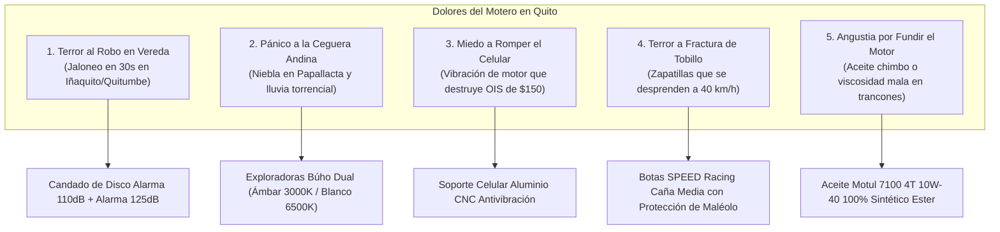

# Estrategia Táctica: Dominar el Nicho Biker en Quito & Ecuador
## Los 5 Disparadores Emocionales que Provocan Compra Inmediata

A diferencia de otros nichos donde la compra es por lujo o vanidad, **en el motociclismo urbano andino la compra está impulsada por el MIEDO A LA PÉRDIDA: perder la vida, perder un pie, perder la herramienta de trabajo o perder la moto.**

En Quito, el motero no compra un "accesorio de aluminio" o un "pedazo de acero": **compra la certeza de que su moto seguirá en la vereda cuando salga del banco, y la tranquilidad de llegar ileso a su casa con su familia.**

---

## 1. El Mapa Emocional del Motero Quiteño



---

## 2. Desglose Táctico de los 5 Sub-Nichos Emocionales & Guiones de Reels

---

### Disparador 1: El Terror de que te Roben la Moto en la Vereda (Modalidad "Jaloneo")

* **La Realidad en Quito:** Dejar la moto parqueada 10 minutos para hacer un trámite en la Amazonas, Quitumbe o la Villa Flora y regresar para encontrar el espacio vacío. Los jaladores rompen el seguro de manubrio en 3 segundos con una palanca.
* **Producto Estrella:** **Candado de Disco con Alarma Sonora 110dB (Aleación de Zinc Antitaladro)**
  * **Costo Bodega/Importación:** \$5.50 – \$7.00 USD.
  * **PVP en Quito:** \$18.99 – \$22.50 USD.
  * **Margen Neto:** 45% – 52% limpio.
* **Guión de Reel "Golpe de Realidad Antirrobo":**

```text
[0:00 - 0:03] HOOK VISUAL IMPACTANTE:
Video de cámara de seguridad real en Quito mostrando a dos sujetos forzando una moto en 15 segundos.
Texto en pantalla: "Así se llevaron una Pulsar en la Villa Flora en 20 segundos 💔🚫"
Audio: Alarma estridente y corte a negro.

[0:04 - 0:10] AGITACIÓN DEL DOLOR:
"El seguro de fábrica del manillar NO SIRVE. Con una simple patada o tubo lo parten en 3 segundos. 
Si dejas tu nave con un candado de ferretería en la vereda, te la van a jalar hoy mismo."

[0:11 - 0:21] DEMOSTRACIÓN FÍSICA DE LA SOLUCIÓN:
(Creador colocando el candado en el disco de freno de una moto. Al moverla levemente, suena la sirena ensordecedora de 110 decibelios).
"Este candado de disco tiene perno de acero endurecido de 6mm y sensor de movimiento con sirena de 110dB. 
Apenas tocan tu moto, el escándalo alerta a toda la cuadra y ahuyenta a los ladrones al instante. Es 100% resistente al agua."

[0:22 - 0:30] OFERTA Y PAGO CONTRA ENTREGA EN QUITO:
"Te llega hoy mismo a tu casa o trabajo en Quito. Lo pruebas, escuchas la alarma y lo PAGAS EN EFECTIVO AL RECIBIR. 
Escribe 'ALARMA' en los comentarios o toca el botón para pedir el tuyo."
```

---

### Disparador 2: Pánico a la Ceguera en Niebla y Lluvia Andina

* **La Realidad en Quito:** Subir a Papallacta, Calacalí o bajar por la vía Alóag a las 6:30 PM. La niebla baja a ras de suelo y la luz blanca o halógena de fábrica crea una "pared blanca" que encandila al piloto. Un bache o un camión detenido sin luces a 10 metros provoca un accidente fatal.
* **Producto Estrella:** **Exploradoras Búho Dual con Lupa Bifocal (Luz Ámbar 3000K + Blanca 6500K)**
  * **Costo Bodega/Importación:** \$11.00 – \$14.00 USD (el par).
  * **PVP en Quito:** \$32.00 – \$38.00 USD.
  * **Margen Neto:** 42% – 48% limpio.
* **Guión de Reel "El Muro de Niebla":**

```text
[0:00 - 0:03] HOOK VISUAL:
Cámara a bordo en la vía a Papallacta con niebla tan espesa que no se ve nada.
Voz con tono de advertencia: "Si ruedas de noche por la sierra ecuatoriana con las luces de fábrica... estás jugando a la ruleta rusa."

[0:04 - 0:11] AGITACIÓN:
"La luz halógena amarilla de tu moto alumbra apenas 8 metros, y la luz blanca común rebota en la niebla como un espejo. 
Un bache o un tráiler parado sin luces te aparece encima cuando ya no puedes frenar."

[0:12 - 0:22] DEMOSTRACIÓN TÉCNICA:
(El motero presiona el switch: la luz ámbar de 3000K corta la niebla e ilumina la carretera a 150 metros con corte láser perfecto).
"Estas exploradoras Búho Dual tienen corte óptico antideslumbrante: el ámbar de 3000K penetra la niebla más densa sin encandilar, 
y la blanca de 6500K te da profundidad en carretera despejada. No queman tu batería y cumplen con la ANT."

[0:23 - 0:30] LLAMADA A LA ACCIÓN:
"Incluyen bases reforzadas y switch de control. Entrega express en Quito con PAGO CONTRA ENTREGA. 
Pide tu par antes de tu próxima ruta tocando el enlace del perfil."
```

---

### Disparador 3: Miedo a Destruir el Celular de Trabajo ($1,200 USD)

* **La Realidad en Quito:** Trabajas 10 horas con Waze o Google Maps. El motor monocilíndrico vibra constantemente. Un día abres la cámara para tomar una foto y la imagen tiembla descontrolada con un zumbido agudo: se rompieron los resortes magnéticos del estabilizador óptico (OIS). En el taller de celulares de El Caracol o el CCI te cobran \$150 por el cambio de módulo.
* **Producto Estrella:** **Soporte de Celular Aluminio CNC con Amortiguación Elastomérica**
  * **Costo Bodega/Importación:** \$7.00 – \$9.50 USD.
  * **PVP en Quito:** \$22.00 – \$26.50 USD.
  * **Margen Neto:** 44% – 50% limpio.
* **Guión de Reel "Tu Moto Está Rompiendo tu iPhone":**

```text
[0:00 - 0:03] HOOK IMPACTANTE:
Pantalla de iPhone con la cámara vibrando incontrolablemente con sonido de zumbido.
Texto en pantalla: "¡Esto le pasa a tu cámara si usas soportes de plástico de $5! 📱💥"

[0:04 - 0:11] AGITACIÓN DEL BOLSILLO:
"Los motores monocilíndricos generan miles de micro-vibraciones por minuto que destruyen el giroscopio de tu cámara. 
Arreglar ese lente en Quito te cuesta entre $120 y $180 USD. Un soporte barato te sale carísimo."

[0:12 - 0:21] DEMOSTRACIÓN FÍSICA:
(El creador golpea el soporte de aluminio con un martillo sin que se deforme, y muestra el sistema de agarre de 4 garras con goma absorbente).
"Este soporte está mecanizado en aluminio CNC de aviación. No se quiebra con los baches de la Simón Bolívar 
y sus elastómeros absorben las frecuencias del motor, manteniendo tu celular fijo y tu cámara 100% protegida."

[0:22 - 0:30] CIERRE COD:
"Se adapta a cualquier manubrio o espejo. Te lo llevamos hoy mismo en Quito con Pago Contra Entrega. 
¡No arriesgues tu celular, pide el tuyo en el botón de abajo!"
```

---

### Disparador 4: El Terror a Fractura de Tobillo / Desprendimiento de Calzado

* **La Realidad en Quito:** El 65% de motociclistas rueda con zapatillas de lona o zapatos de vestir. En una caída a apenas 35 km/h en asfalto mojado, el primer instinto es bajar el pie. La zapatilla sale despedida por el arrastre, dejando la piel y el hueso del maléolo expuestos a fricción directa con el pavimento. Meses con clavos y sin poder trabajar.
* **Producto Estrella:** **Botas SPEED Racing Caña Media/Alta con Protección de Maléolo y Sliders TPU**
  * **Costo Bodega/Importación:** \$24.00 – \$29.00 USD.
  * **PVP en Quito:** \$68.00 – \$78.00 USD.
  * **Margen Neto:** 40% – 46% limpio.
* **Guión de Reel "Zapatillas vs Asfalto":**

```text
[0:00 - 0:03] HOOK DE CONCIENCIA CRUDA:
(Plano de zapatilla de lona destrozada y raspada contra el piso).
Voz firme: "En una caída en moto a 40 km/h, una zapatilla de lona dura exactamente 0.3 segundos antes de desaparecer."

[0:04 - 0:10] AGITACIÓN MÉDICA:
"El 65% de las lesiones graves en moto en Ecuador son fracturas de tobillo y pérdida de piel en el pie. 
Unas zapatillas comunes no tienen soporte antitorsión ni resistencia a la abrasión."

[0:11 - 0:22] DEMOSTRACIÓN DE LA ARMADURA:
(Mostrar las botas SPEED: rigidez de la caña, copa reforzada en el talón, slider reemplazable de titanio/TPU y suela antideslizante).
"Las botas SPEED Racing tienen protección rígida de maléolo que evita la fractura por torsión si la moto te cae encima. 
Su suela de compuesto de caucho agarra en asfalto mojado con aceite, y tienen refuerzo especial para hacer cambios sin desgastar la bota."

[0:23 - 0:30] REVERSIÓN TOTAL DE RIESGO:
"¿Dudas de tu talla? Nuestro motorizado te lleva dos tallas a tu casa en Quito para que te las pruebes tranquilo. 
Pagas en efectivo solo si te quedan perfectas. Escribe 'BOTAS' para coordinar."
```

---

### Disparador 5: Angustia por Fundir el Motor por Aceite Adulterado en Tráfico

* **La Realidad en Quito:** Motores enfriados por aire parados 40 minutos en el trancón de El Trébol o la Mariscal Sucre al mediodía. La temperatura del cárter sube a 130°C. Si el aceite es mineral barato o adulterado, la película lubricante se rompe, el pistón se recuesta contra el cilindro y el motor se funde. Reparación de \$250 a \$400 USD.
* **Producto Estrella:** **Aceite Motul 7100 4T 10W-40 100% Sintético con Tecnología Éster (Sello Original Garantizado)**
  * **Costo Mayorista Local:** \$13.50 – \$14.50 USD.
  * **PVP en Quito:** \$19.50 – \$21.50 USD.
  * **Margen Neto:** 25% – 30% (producto gancho de altísima recurrencia cada 3,000 km).
