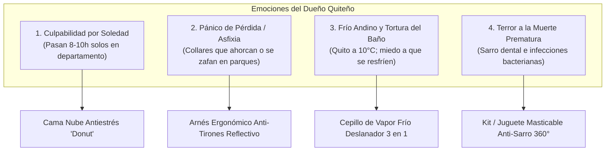

# Estrategia Táctica: Dominar el Nicho "Perrhijos" en Quito

El término **"perrhijo"** o **"gathijo"** describe una transformación sociocultural profunda en ciudades como Quito: los animales ya no son guardianes de patio, sino **miembros del núcleo familiar** y sustitutos de hijos para millennials, centennials y parejas sin hijos (DINKs) en sectores como La Carolina, Cumbayá, Monteserrín, González Suárez y Valles.

En este mercado, **el cliente no busca un precio barato, busca aliviar una culpa o garantizar la felicidad y protección de su mascota.**

---

## 1. Los 4 Disparadores Emocionales que Provocan Compra Inmediata



---

## 2. Desglose Táctico de los 4 Sub-Nichos Emocionales

### Disparador 1: La Culpabilidad de Dejarlo Solo (Ansiedad por Separación)
* **La Realidad en Quito:** Profesionales que salen a trabajar de 8:00 a 18:00 dejando a su perro encerrado en un departamento de 60 $m^2$. Los vecinos se quejan de aullidos o el perro destruye zapatos por estrés.
* **Producto Estrella:** **Cama Nube Antiestrés Tipo Dona (Calming Bed)**
  * **Costo en Bodega/Dropi:** \$6.50 – \$9.00 USD (llega comprimida al vacío, bajo costo de flete).
  * **PVP en Quito:** \$24.99 (talla S) – \$34.99 (talla M/L).
  * **Margen Neto:** 36% – 42% limpio.
* **El Guión de Reel "Ataque a la Culpa":**

```text
[0:00 - 0:03] HOOK EMOCIONAL (GOLPE AL CORAZÓN):
Video de cámara de seguridad mostrando al perrito sentado mirando fijamente la puerta cerrada.
Texto en pantalla: "Esto es lo que hace tu perrito las 8 horas que lo dejas solo en tu departamento en Quito 💔"

[0:04 - 0:11] AGITACIÓN DE LA CULPA:
"Nosotros salimos a trabajar, vemos gente, nos distraemos... pero todo su mundo eres tú. 
El 70% de los perros en Quito sufren de ansiedad por separación y pasan el día temblando de estrés o aullando."

[0:12 - 0:21] DEMOSTRACIÓN DE LA SOLUCIÓN:
(Corte al perrito durmiendo profundamente acurrucado en la cama afelpada).
"Esta cama dona imita el pelaje y el calor de su madre. Sus bordes elevados le dan soporte a su cabeza 
y cuello, liberando oxitocina y reduciendo su ritmo cardíaco para que duerma relajado todo el día."

[0:22 - 0:30] OFERTA LOCAL CONTRA ENTREGA:
"Dale la paz que se merece. Entrega express en Quito en 24 horas y pagas al recibir en tu puerta. 
Haz clic abajo y regálale su lugar seguro."
```

---

### Disparador 2: El Pánico de Seguridad y Pérdida (La Tragedia Evitable)
* **La Realidad en Quito:** Pasear en el Parque La Carolina, Bicentenario o Chaquiñán de noche. Los collares tradicionales aplastan la tráquea cuando el perro jala bruscamente, o se zafan y el perro sale corriendo hacia una avenida concurrida (Av. Amazonas o Simón Bolívar).
* **Producto Estrella:** **Arnés Antitirones Ergonómico con Costuras Reflectivas 3M**
  * **Costo en Bodega:** \$4.00 – \$6.00 USD.
  * **PVP en Quito:** \$21.99 – \$24.99 USD.
  * **Margen Neto:** 40% – 46%.
* **El Guión de Reel "Alerta Roja":**

```text
[0:00 - 0:03] HOOK DE PÁNICO / SEGURIDAD:
Toma de un perro tosiendo y ahogándose mientras pasea con un collar al cuello.
Texto en pantalla: "¡Por favor, deja de pasear a tu perro con collar al cuello en Quito! 🛑"

[0:04 - 0:10] AGITACIÓN MÉDICA:
"Cada vez que tu perro tira, toda la fuerza va directo a su tráquea y tiroides. 
Muchos veterinarios en Ecuador atienden colapsos traqueales irreversibles por esta mala costumbre."

[0:11 - 0:20] DEMOSTRACIÓN DEL ARNÉS:
"Este arnés antitirones distribuye la fuerza uniformemente en su pecho, no en su cuello. 
Además, tiene costuras reflectivas 3M que brillan en la oscuridad para que los autos lo vean a 100 metros en los paseos nocturnos."

[0:21 - 0:30] CIERRE CONTRA ENTREGA:
"Protege su vida hoy mismo. Envío gratis a todo Quito y pagas en efectivo en tu casa por solo $21.99. 
Toca el botón y elige su talla."
```

---

### Disparador 3: El Frío de Quito y la Tortura del Baño (Confort Sin Trauma)
* **La Realidad en Quito:** Clima templado-frío (madrugadas de 9°C). Bañar a un perro o gato en casa con manguera o ducha suele terminar en neumonía, estrés extremo y pelos pegados en todas las paredes.
* **Producto Estrella:** **Cepillo de Vapor 3 en 1 con Micro-Neblina Fría y Cerdas de Masaje**
  * **Costo en Bodega:** \$3.80 – \$5.00 USD.
  * **PVP en Quito:** \$19.99 – \$22.99 USD.
  * **Margen Neto:** 42% – 48%.
* **El Guión de Reel "Satisfacción y Ternura":**

```text
[0:00 - 0:03] HOOK VISUAL ASMR:
Gato o perro con los ojos entrecerrados de placer mientras una capa de pelo se despega como alfombra.
Texto en pantalla: "Para los que tenemos perrhijos o gathijos en el frío de Quito ☁️🐱"

[0:04 - 0:11] AGITACIÓN:
"Bañarlos seguido con el clima de la sierra les causa alergias y tos, pero si no los cepillas, 
sueltan pelos que terminan en tu cama, en tus sillones y en tu comida."

[0:12 - 0:21] DEMOSTRACIÓN:
"Este cepillo pulveriza una brisa de agua fría que atrapa el pelo muerto sin mojarlo por completo. 
Sus cerdas de silicona médica le dan un masaje relajante mientras retiras kilos de pelo en 3 minutos."

[0:22 - 0:30] OFERTA:
"Tu casa libre de pelos y tu mascota feliz. Pídelo hoy en Quito con Pago Contra Entrega. 
Pagas cuando el cartero te lo entregue en mano."
```

---

### Disparador 4: El Miedo a la Enfermedad Silenciosa (Salud Dental Canina)
* **La Realidad en Quito:** Los dueños no revisan el hocico de sus perros. Cuando van al veterinario, el perro tiene encías sangrantes y sarro negro. La limpieza dental en una clínica de Quito cuesta entre \$60 y \$120 USD y requiere anestesia general (a la que muchos perros ancianos no sobreviven).
* **Producto Estrella:** **Masticable Dental 360° con Ranuras Limpiadoras o Spray Dental Enzimático**
  * **Costo:** \$3.50 – \$4.50 USD.
  * **PVP:** \$18.99 – \$21.99 USD.
* **El Guión de Reel "Diagnóstico Impactante":**

```text
[0:00 - 0:03] HOOK DE SHOCK MÉDICO:
Foto de dientes con sarro amarillo/marrón.
Texto en pantalla: "Si el aliento de tu perro huele a podrido, sus riñones están en peligro ⚠️"

[0:04 - 0:11] CONCIENTIZACIÓN:
"El 80% de los perros en Ecuador sufren de enfermedad periodontal a los 3 años. 
Las bacterias del sarro viajan por el torrente sanguíneo dañando su corazón y acortando su vida hasta 4 años."

[0:12 - 0:21] SOLUCIÓN FÁCIL:
"En lugar de pagar $100 por una anestesia peligrosa, este cepillo masticable de caucho natural limpia sus muelas 
y retira el sarro acumulado como un juego mientras muerde."

[0:22 - 0:30] CIERRE:
"Añádele años de vida a tu mejor amigo. Disponible con entrega en Quito en 24h. Pago contra entrega."
```

---

## 3. Matriz de Rentabilidad en Quito para Productos de Mascotas

| Producto Emocional | Costo Proveedor | PVP Sugerido | Flete Local COD | Margen Neto Estimado | Tasa Devolución Prevista | Nivel de Viralidad |
| :--- | :---: | :---: | :---: | :---: | :---: | :---: |
| **Cama Nube Antiestrés** | \$8.00 | **\$29.99** | \$4.00 (Comprimida) | **38% (\$11.40 USD)** | 12% | ⭐⭐⭐⭐⭐ (Amor/Culpa) |
| **Cepillo Vapor 3 en 1** | \$4.20 | **\$21.99** | \$3.50 | **44% (\$9.60 USD)** | 8% | ⭐⭐⭐⭐⭐ (ASMR/Pelos) |
| **Arnés Anti-Tirones 3M** | \$5.00 | **\$23.99** | \$3.50 | **42% (\$10.10 USD)** | 10% | ⭐⭐⭐⭐ (Seguridad) |
| **Masticable Dental 360** | \$3.20 | **\$19.99** | \$3.50 | **45% (\$9.00 USD)** | 9% | ⭐⭐⭐⭐ (Salud/Shock) |

---

## 4. Fórmula para Anuncios en Meta Ads (Segmentación Quito)

Para venderle a los dueños de "perrhijos" en Quito sin quemar presupuesto publicitario:

* **Ubicación Geográfica:** Quito (+25 km a la redonda, abarcando Cumbayá, Tumbaco, Los Chillos, Carcelén, Ponciano, Centro-Norte).
* **Edad:** 24 a 48 años (millennials con poder adquisitivo que tratan a sus mascotas como hijos).
* **Intereses Clave en Meta:**
  * *Perro (Mascota)* / *Gato* / *Cuidado de animales*.
  * Marcas de comida premium: *Royal Canin*, *Taste of the Wild*, *Purina Pro Plan*.
  * *Dog training* / *Veterinaria*.
* **Estructura de Campaña:**
  * 1 Campaña CBO con \$15 - \$20 USD diarios.
  * 3 Conjuntos de Anuncios:
    1. Intereses Amplios de Mascotas.
    2. Intereses Específicos (Royal Canin / Gatos / Adiestramiento).
    3. Totalmente Abierto (Broad: solo Quito + 22 a 50 años; el video filtrará solo a dueños de mascotas).
