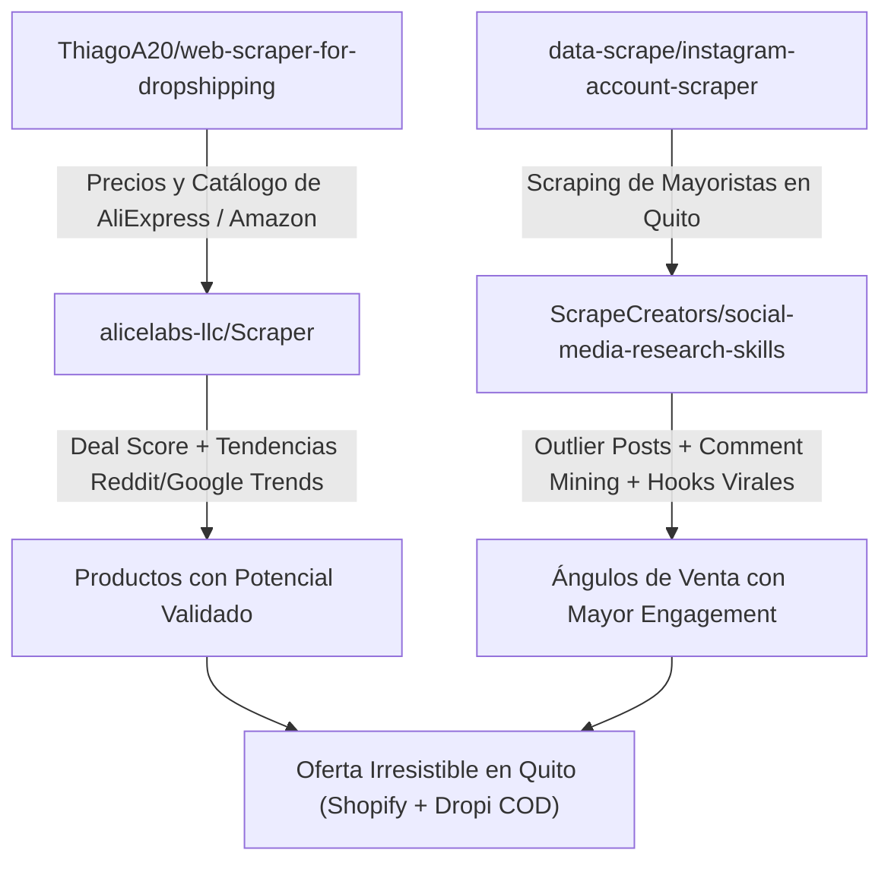
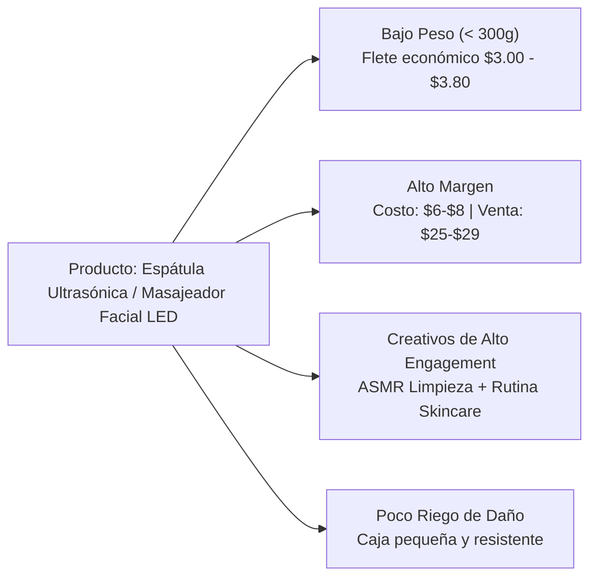

# Estudio Estratégico: Dropshipping en Quito vs. Mayoristas Locales

Este informe detalla la arquitectura técnica para integrar las 4 herramientas de GitHub, el mapeo de competidores mayoristas en Quito (Google e Instagram), los nichos internacionales más virales y la selección del nicho óptimo para explotar en el mercado ecuatoriano bajo la modalidad de **Pago Contra Entrega (COD)**.

---

## 1. Arquitectura de Inteligencia de Datos (Las 4 Herramientas)

Para montar un pipeline automatizado de investigación de mercado, las 4 herramientas no se usan de forma aislada, sino en un embudo coordinado de 4 etapas:

### Funciones específicas de cada repositorio:

1. **`ThiagoA20/web-scraper-for-dropshipping` (Extracción de Producto Base)**:
   * **Objetivo:** Raspar títulos, especificaciones técnicas, galerías de imágenes y rangos de precio en AliExpress, Amazon y eBay.
   * **Utilidad práctica:** Define el costo base internacional en USD para calcular márgenes brutos antes de buscarlo en bodegas locales de Ecuador.

2. **`alicelabs-llc/Scraper` (Scoring con IA y Señales de Mercado en Vivo)**:
   * **Objetivo:** Motor de inteligencia con soporte BYOK (Gemini, Claude, DeepSeek, OpenAI) que extrae señales en tiempo real de Reddit (`r/dropship`, `r/ecommerce`), Google Trends y calcula un **Deal Score (0 a 100)**.
   * **Utilidad práctica:** Filtra los productos de AliExpress para descartar modas pasajeras y priorizar artículos con demanda ascendente demostrada.

3. **`data-scrape/instagram-account-scraper` (Espionaje a Mayoristas Locales)**:
   * **Objetivo:** Extraer perfiles, volumen de seguidores, publicaciones recientes, métricas de engagement y reels de competidores en Quito.
   * **Utilidad práctica:** Mapea el inventario que los mayoristas de Quito ya están promocionando y detecta qué productos tienen interacción orgánica activa en Ecuador.

4. **`ScrapeCreators/social-media-research-skills` (Análisis de Contenido y Objeciones)**:
   * **Objetivo:** Suite de 13 habilidades de IA para análisis social profundo.
   * **Habilidades clave a ejecutar:**
     * `Outlier Post Finder`: Detecta reels que lograron 5x a 10x más reproducciones que el promedio de la cuenta (identificando el producto viral exacto).
     * `Transcript Intelligence`: Desglosa los primeros 3 segundos (hook), la promesa de venta y la llamada a la acción (CTA).
     * `Comment Mining`: Rastrea dudas recurrentes en el público ecuatoriano (*"¿Hacen entregas en el Quicentro?", "¿Cuánto cobran el envío a Carapungo?", "¿Tienen garantía?"*).

---

## 2. Ranking de Tiendas con Más Seguidores y Engagement en Instagram (Ecuador / Quito)

A continuación se comparan los perfiles con mayor audiencia en el país y su comportamiento de engagement:

| Rank | Cuenta | Seguidores Aprox. | Categoría Principal | Tasa de Engagement | Tipo de Contenido Predominante | Brecha Explotable para Dropshipping |
| :---: | :--- | :---: | :--- | :---: | :--- | :--- |
| **#1** | **`@deprati`** | **~850K - 900K** | Moda, Skincare, Belleza y Hogar | Media (0.8% - 1.2%) | Sesiones de moda, influencers top, branding aspiracional | Precios altos y catálogo rígido; no comercializan gadgets virales de impulso. |
| **#2** | **`@dipasobelleza`** | **~350K** | Skincare Coreano, Capilar, Maquillaje | **Alta (2.5% - 4.2%)** | Tutoriales, rutinas de cuidado, reseñas prácticas de productos | Enfocados en consumibles (cremas, tintes); descuidan la aparatología facial portátil. |
| **#3** | **`@novicompu`** | **~320K** | Tecnología, Computación, Celulares | Baja (0.6% - 1.0%) | Flyers estáticos de ofertas, precios de combos y tiendas físicas | Venta tradicional de retail; no hacen videos de soluciones prácticas ni venta de impulso. |
| **#4** | **`@pycca`** | **~180K - 220K** | Hogar, Limpieza, Muebles | Baja (~0.5%) | Catálogo estático de electrodomésticos y decoración | Productos voluminosos y costosos; no abarcan gadgets de limpieza ergonómicos de CleanTok. |
| **#5** | **`@mecimportadora`** | **~40K - 80K** | Hogar, Cocina, Novedades en Bodega | **Muy Alta en Reels (> 5.0%)** | Videos caseros en bodega mostrando cajas y stock al por mayor | **Cero checkout:** Dicen "Precio al DM" o "Escriban a WhatsApp", perdiendo 80% de ventas impulsivas. |
| **#6** | **`@importadoramustafa`** | **~30K - 50K** | Tecnología, Novedades del Sur de Quito | **Alta en Reels (~3.5%)** | Demostraciones rápidas de novedades chinas recién desempacadas | No tienen garantía clara ni branding; compiten exclusivamente por céntimos. |

---

## 3. Mapa Competitivo en Quito (Google e Instagram)

Para competir eficazmente con los distribuidores tradicionales de la capital, es fundamental conocer sus posiciones y sus puntos ciegos:

### Principales Jugadores en Quito

| Categoría | Jugador / Canal | Enfoque de Mercado | Canal Principal |
| :--- | :--- | :--- | :--- |
| **Multicategoría / Bazar** | **Mega Mayorista Quito** (Av. Huancavilca) | Tecnología, hogar, camping, belleza al por mayor | Google Web / Local Físico |
| **Importación China Directa** | **Importadora MEC** (Av. Occidental) | Novedades, cocina, gadgets, organización del hogar | Instagram (`@mecimportadora`) |
| **Importación Rápida / Novedades** | **Importadora Mustafa** (La Magdalena - Sur) | Novedades virales, accesorios, tecnología | Instagram (`@importadoramustafa`) |
| **Tecnología y Gadgets** | **Blue Magic** (Av. de los Shyris - Norte) | Consolas, audio, gadgets de tendencia | Instagram (`@bluemagic_ec`) |
| **Electrónica y Seguridad** | **Impormel** (Norte de Quito) | Equipos de seguridad, electrónica, herramientas | Google SEO / Web Oficial |
| **Belleza & Salón** | **Montero / Zoeimport Mayoristas** | Cuidado capilar, aparatología, maquillaje profesional | Web y Catálogo WhatsApp |
| **Canal Informal Tradicional** | **El Tejar / C.C. Hermano Miguel / Ipiales** | Precio más bajo sin marca ni garantía | Venta presencial en efectivo |

### Por qué un Dropshipper puede vencer a un Mayorista en Quito

> [!IMPORTANT]
> Los mayoristas de Quito compiten por **precio y volumen**, descuidando completamente la **experiencia de compra digital**. Ahí reside tu ventaja competitiva:

1. **Contenido visual deficiente:** Los mayoristas suben fotos estáticas en baja resolución o videos de 10 segundos en bodega con mala iluminación. No saben crear videos con gancho emocional (*Hook -> Agitation -> Solution*).
2. **Fricción logística para el comprador:** Para comprarle a un mayorista de El Tejar o de la Av. Huancavilca, el cliente debe ir físicamente al tráfico del centro/sur o hacer una transferencia bancaria previa a una cuenta desconocida.
3. **El poder del Pago Contra Entrega (COD):** Más del 70% de las ventas digitales en Ecuador se concretan si el cliente paga en efectivo cuando el repartidor toca a su puerta (vía Servientrega, Laar Courier o motorizados urbanos en Quito).
4. **Venta de soluciones, no de objetos:** El mayorista vende una *"mini máquina depiladora $7.00"*. Tú vendes *"Elimina el vello de raíz sin dolor desde casa en 5 minutos con envío gratis a Quito y paga al recibir por $27.99"*.

---

## 3. Análisis de Nichos Más Virales a Nivel Internacional

Los productos con mayor tracción en TikTok Shop y Meta Ads en 2024-2026 cumplen 3 condiciones: **altamente visuales**, **demostrables en menos de 3 segundos** y **dirigidos a un dolor o deseo urgente**.

### Nicho 1: Smart Beauty & Cuidado Facial en Casa
* **Productos estrella:**
  * *Ultrasonic Skin Scrubber* (Espátula ultrasónica limpiadora de poros).
  * *Depiladoras IPL de luz pulsada compactas*.
  * *Cepillos secadores y moldeadores multifunción 5 en 1*.
* **Por qué es viral:** Formato de video "Antes vs. Después" muy adictivo. Las espátulas sacando impurezas o los cambios capilares generan retención inmediata.
* **Métricas:** Márgenes del 60% al 75%. Ticket promedio: \$25 - \$38 USD.

### Nicho 2: CleanTok & Organización Inteligente del Hogar
* **Productos estrella:**
  * *Electric Spin Scrubber* (Cepillo giratorio eléctrico inalámbrico con cabezales intercambiables).
  * *Selladores térmicos portátiles de bolsas con cortador*.
  * *Dispensadores automáticos de jabón y espuma con sensor*.
* **Por qué es viral:** Satisface la psicología del orden y la limpieza profunda ("Satisfying Cleaning Videos"). Son videos fáciles de recrear en cualquier cocina o baño.
* **Métricas:** Ticket promedio: \$19 - \$32 USD.

### Nicho 3: Alivio Físico y Bienestar Postural
* **Productos estrella:**
  * *Masajeadores cervicales de pulso electromagnético / térmicos*.
  * *Fajas térmicas lumbares con vibración*.
  * *Pistolas de percusión muscular compactas*.
* **Por qué es viral:** Apela a un público de 28 a 55 años que trabaja sentado frente al computador y sufre de dolor de cuello/espalda. La compra es por impulso para calmar el dolor.
* **Métricas:** Ticket promedio: \$24 - \$35 USD.

---

## 4. El Nicho Más Fácil de Explotar en Quito

Tras contrastar la logística local ecuatoriana, las tarifas de paquetería y el comportamiento de compra en Quito, el nicho ganador es:

### 🏆 Ganador: **Aparatología Portátil de Cuidado Facial y Belleza (Smart Skincare Tools)**

### Justificación Técnica y Operativa para Quito:

1. **Eficiencia en Costos de Envío y Devoluciones:**
   * En Ecuador, couriers como Laar Courier y Servientrega cobran por peso y volumen. Un cepillo de limpieza o espátula facial pesa menos de 350 gramos.
   * Si un cliente en Quito o provincias rechaza la entrega, el costo del flete de devolución (novedad) es mínimo (\$2.00 - \$3.50), a diferencia de productos grandes de hogar que duplican el costo de retorno.
2. **Estructura Financiera (Números en USD):**
   * **Costo mayorista en bodega local (Dropi Ecuador / Mayorista Quito):** \$6.50 - \$8.50 USD.
   * **Flete promedio con recaudo COD:** \$3.50 - \$4.50 USD.
   * **Costo por Adquisición estimado (CPA en Meta Ads):** \$4.00 - \$6.00 USD.
   * **Precio de Venta al Público (PVP):** \$27.00 - \$29.99 USD.
   * **Margen Neto por orden entregada:** **\$8.00 - \$13.00 USD (30% - 45% Neto)**.
3. **Engagement en Redes Sociales:**
   * El skincare y la estética facial tienen uno de los CPMs más rentables en Meta e Instagram en Ecuador cuando se orientan a mujeres y hombres de 20 a 45 años.
   * Los comentarios se llenan de preguntas naturales (*"¿Sirve para piel grasa?", "¿Dónde están ubicados?", "¿Tienen contra entrega en el Valle de los Chillos?"*), lo que alimenta el algoritmo de Instagram para viralizar los Reels.

---

## 5. Plan de Acción Táctico para Implementar

Para poner a rodar el proyecto en el espacio de trabajo:

1. **Configurar el Scraper de Productos:**
   * Clonar `alicelabs-llc/Scraper` y `ThiagoA20/web-scraper-for-dropshipping` para extraer el listado de los 10 productos de belleza más calificados en AliExpress.
2. **Minar Contenidos y Competencia Local:**
   * Clonar `data-scrape/instagram-account-scraper` para extraer los últimos 30 reels de `@mecimportadora`, `@importadoramustafa` y tiendas locales de skincare en Ecuador.
   * Aplicar las habilidades de `social-media-research-skills` (`comment-mining` y `outlier-post-finder`) para extraer los ganchos virales con más de 100k views y las principales objeciones de los compradores ecuatorianos.
3. **Plataforma y Fulfillment:**
   * Vincular tu tienda (Shopify) con el catálogo local de **Dropi Ecuador** para despachar desde bodegas nacionales en Quito/Guayaquil sin necesidad de importar contenedores propios desde el día 1.
   * Implementar un formulario contra entrega (COD) simple de un solo paso.
   * Integrar confirmación de pedidos vía WhatsApp antes del despacho para mantener la tasa de entrega por encima del 85%.
