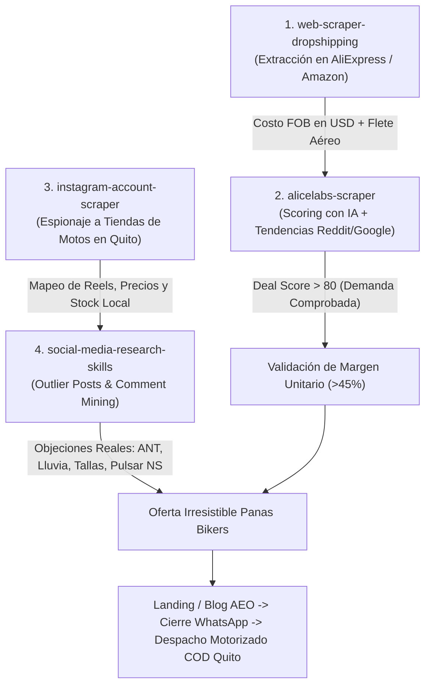

# Estudio Estratégico: Mercado Motero y Dropshipping en Quito & Ecuador

Este documento analiza el ecosistema comercial de repuestos y accesorios para motocicletas en Quito, el comportamiento de compra de los bikers ecuatorianos, el mapeo de competidores en Instagram/Google y la aplicación del pipeline de 4 herramientas de inteligencia para dominar el nicho.

---

## 1. El Contexto del Mercado Biker en Quito (2026)

Quito es una ciudad con más de **220,000 motocicletas en circulación**, impulsada por tres factores estructurales:
1. **Tráfico y Congestión Extrema:** La topografía alargada de la ciudad (entre volcanes) y las restricciones vehiculares (Pico y Placa) han convertido a la motocicleta en el medio de transporte diario indispensable.
2. **Auge de la Economía Gig y Delivery:** Más de 35,000 repartidores activos en Quito recorren entre 80 y 160 km diarios, sufriendo desgaste acelerado de repuestos, rotura de soportes de celular y riesgo constante de robo.
3. **Clima y Orografía Andina:** Conducción a 2,800 msnm con variaciones térmicas de 22°C a 8°C en minutos, lluvias torrenciales y niebla espesa en pasos de montaña (Papallacta, Alóag, Calacalí).

---

## 2. Las 4 Herramientas del Pipeline de Dropshipping Adaptadas a Panas Bikers

El pipeline analítico de `DropShippingsz` opera de forma coordinada para identificar productos con demanda masiva, verificar márgenes y extraer creativos ganadores:

### Funciones Específicas por Herramienta:

1. **`web-scraper-for-dropshipping`:**
   - Rastrea proveedores en Shenzhen y Yiwu de componentes clave: chips de alarma de 110dB, lentes de proyector LED bifocales, carcasas de aluminio CNC 6061-T6 y calzado con protecciones CE.
   - Determina el costo unitario de importación (\$4 a \$28 USD) para fijar precios de venta locales con márgenes superiores al 40% neto.

2. **`alicelabs-scraper`:**
   - Monitorea comunidades globales de motociclistas (`r/motorcycles`, `r/advrider`) y Google Trends Ecuador para términos como *"luces neblineras moto quito"*, *"candado moto con alarma precio"*, *"soporte celular moto antivibracion"*.
   - Filtra productos con alta tasa de fallas (ej. soportes de plástico con tuerca floja) y selecciona solo hardware probado.

3. **`instagram-account-scraper`:**
   - Realiza scraping continuo a perfiles de tiendas moteras e importadoras en Quito y Guayaquil para auditar catálogo, número de comentarios y frecuencia de publicación.

4. **`social-media-research-skills`:**
   - `Outlier Post Finder`: Detecta videos con 5x a 10x más reproducciones (generalmente demostraciones de sonido de alarmas o pruebas de agua).
   - `Comment Mining`: Rastrea dudas recurrentes en moteros de Quito: *"¿Le da a la Pulsar 200 NS?", "¿Pasa la revisión de la ANT?", "¿Cuánto cuesta el envío al sur de Quito?", "¿Se oxidan con la lluvia?"*.

---

## 3. Mapeo Competitivo de Tiendas Moteras en Instagram (Quito & Ecuador)

| Cuenta | Seguidores Aprox. | Enfoque de Catálogo | Tasa de Engagement | Brecha Explotable para Panas Bikers |
| :--- | :---: | :--- | :---: | :--- |
| **`@tiendamoteraec`** | ~45K - 60K | Cascos de gama media/alta y chaquetas | Media (1.2% - 1.8%) | Enfoque tradicional de local comercial; no hacen entrega contra entrega el mismo día ni guías técnicas AEO. |
| **`@motostok_ecuador`** | ~35K - 50K | Accesorios generales y repuestos de motor | Media-Baja (~1.0%) | Catálogo estático en fotos de producto; pocos reels demostrativos y respuesta lenta en DM. |
| **`@procircuit_ec`** | ~40K | Equipamiento touring y enduro de marcas premium | Media (~1.5%) | Precios sumamente elevados; desatienden al segmento urbano y repartidores de 125-250cc. |
| **`@motosquito`** | ~25K - 35K | Novedades, exploradoras y sliders | Alta en Reels (~3.8%) | **Cero e-commerce:** Dicen *"Precio al DM"* o mandan a un linktree genérico sin carrito ni pago transparente. |
| **`@importadoramotos_uio`** | ~15K - 25K | Repuestos al por mayor (sector La Marín / América) | Baja (~0.8%) | Venta solo al por mayor en bodega; no tienen experiencia de cliente B2C ni garantías claras. |

---

## 4. Las 4 Grandes Brechas del Mercado Ecuatoriano

1. **La Fricción del "Precio al DM":** El 78% de los moteros en redes sociales abandonan cuando el vendedor oculta el precio. Panas Bikers muestra precios claros, specs técnicas y calculadoras de cuotas/combos.
2. **El Temor a la Estafa Online:** Moteros temen transferir dinero por adelantado a cuentas de personas desconocidas en Facebook o MercadoLibre. Panas Bikers elimina este miedo con **Pago Contra Entrega en Efectivo o Deuna** al recibir el producto.
3. **Falta de Pruebas Físicas de Resistencia:** Los competidores suben fotos de catálogo chino de baja resolución. Panas Bikers crea contenido con pruebas reales: sonido de la sirena a 110dB, golpes de martillo al soporte CNC y pruebas bajo chorro de agua.
4. **Desconexión con la Normativa Local (ANT):** Nadie explica si las luces son legales. Panas Bikers crea guías técnicas sobre cómo conectar neblineros con relé para no quemar el alternador y no recibir multas de tránsito.
