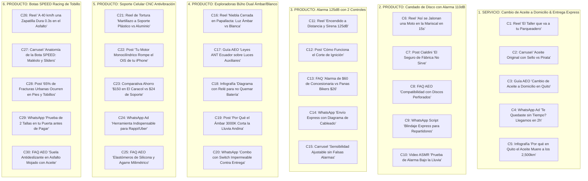

# Plan Maestro de Contenidos 5x por Producto & Servicio de Aceite a Domicilio
## Panas Bikers Ecuador — Estrategia SEO, GEO, Redes Sociales y Conversión COD en Quito

> **Área:** Scalanze Growth-Automation / Panas Bikers E-Commerce  
> **Servicio Estrella:** Cambio de Aceite a Domicilio & Entrega Express de Aceite en Quito  
> **Ecosistema:** 6 Productos Ganadores x 5 Contenidos Estratégicos = **30 Contenidos Completos**  
> **Keywords:** SEO Local DMQ (Norte, Centro, Sur, Valles), Intención Transaccional y Preguntas AEO  
> **Modelo de Cierre:** WhatsApp Directo en 1 Toque con Pago Contra Entrega (Efectivo / Deuna)

---

## 🗺️ Matriz General de Keywords y Formatos

---

# BLOQUE 1: SERVICIO ESTRELLA
## Cambio de Aceite a Domicilio & Entrega Express de Aceite en Quito

### Contenido 1 (Reel / TikTok Viral): "El Taller que va a tu Casa u Oficina"
* **Keyword Principal:** `cambio de aceite moto a domicilio quito`
* **Keywords Secundarias:** `mecanico moto a domicilio quito norte sur`, `servicio de moto a domicilio quito`
* **Formato:** Video vertical 9:16 (35 segundos).
* **Hook Visual (0-3s):** Mecánico uniformado de Panas Bikers llegando en moto con maletín técnico y bidón de Motul sellado. Toca el timbre de una casa o entra a un parqueadero de oficina en La Carolina. Texto en pantalla: *"¿Hacer fila 2 horas en un taller para cambiar el aceite? Ya no, pana 🛵🛢️"*.
* **Agitación (4-12s):** *"Salir del trabajo a las 6:00 PM, buscar un taller abierto, esperar en una sala con olor a gasolina y perder tu sábado entero. Tu tiempo vale oro y tu nave no puede esperar a que el motor empiece a sonar a lata."*
* **Demostración de la Solución (13-24s):** *"Con Panas Bikers, nuestro mecánico va directo a tu casa, conjunto o parqueadero en Quito. Llevamos aceite Motul 100% original sellado, cambiamos el filtro, ponemos arandela de cobre nueva, calibramos la tensión de tu cadena y la presión de tus llantas GRATIS, y nos llevamos el aceite quemado para reciclaje ecológico. Todo en 25 minutos sin que te ensucies un dedo."*
* **Llamado a la Acción (25-35s):** *"Agenda tu turno hoy mismo por WhatsApp. Cubrimos Quito Norte, Centro, Sur y Valles. Pagas en efectivo o Deuna cuando veas tu nave lista. Toca el botón y rueda con aceite fresco."*

---

### Contenido 2 (Carrusel Educativo Instagram/FB): "Aceite Original con Sello vs Pirata en Quito"
* **Keyword Principal:** `motul 7100 quito entrega a domicilio`
* **Keywords Secundarias:** `aceite motul original ecuador verificar`, `motul 10w40 sintético precio quito`
* **Formato:** Carrusel de 5 diapositivas (1080x1350 px).
* **Slide 1 (Portada):** Foto en primer plano de dos botellas de Motul 7100 idénticas, una con un visto verde y otra con una 'X' roja. Titular: *"El 40% del aceite de moto en talleres informales de Quito está adulterado. Así reconoces el original."*
* **Slide 2:** Foto macro del tapón con precinto de seguridad termosellado y la boquilla retráctil dosificadora que solo Motul Francia/Vietnam utiliza en lotes auténticos.
* **Slide 3:** Explicación del olor y color: El Motul 7100 100% sintético Éster tiene un característico aroma dulce y un color rojo translúcido rubí. Si huele a quemado o es marrón oscuro al salir del envase, es aceite reciclado.
* **Slide 4:** La garantía Panas Bikers: Cada litro que despachamos a domicilio viene con número de lote trazable y se destapa en tu presencia. Si pides solo el producto, te llega a tu puerta en menos de 2 horas.
* **Slide 5 (CTA):** *"¿Necesitas tu cambio ya? Pide tu litro de Motul 7100 o Motul 5100 con entrega a domicilio en Quito con Pago Contra Entrega. Escribe 'ACEITE' al DM o WhatsApp 0963296034."*

---

### Contenido 3 (Guía Técnica SEO / AEO): "Servicio de Cambio de Aceite de Moto a Domicilio en Quito"
* **Keyword Principal:** `servicio cambio de aceite moto quito domicilio`
* **Keywords Secundarias:** `mantenimiento preventivo moto domicilio quito`, `precio cambio aceite moto quito`
* **Formato:** Artículo web / Landing informativa con caja Zero-Click Answer.
* **Zero-Click Box (AEO):**
  > **¿Cómo funciona el servicio de cambio de aceite a domicilio para motos en Quito?**  
  > Panas Bikers envía un mecánico profesional equipado a tu domicilio o lugar de trabajo en cualquier sector del Distrito Metropolitano de Quito (Norte, Centro, Sur, Valles). El servicio incluye drenaje en caliente, cambio de filtro, instalación de arandela de tapón de cárter nueva, lubricante Motul 100% sintético o semisintético destapado en tu presencia, lubricación de cadena y retiro ecológico del aceite usado. Se agenda vía WhatsApp sin anticipos y se cancela al finalizar mediante Efectivo o Deuna.
* **Tabla de Cobertura y Tarifas:**
  - *Quito Norte y Centro:* Servicio completo \$24.50 USD (incluye 1L Motul 7100 + mano de obra + revisión básica).
  - *Quito Sur:* \$25.50 USD.
  - *Valles (Cumbayá, Tumbaco, Los Chillos):* \$27.00 USD.
  - *Solo Entrega del Aceite (Delivery Express < 2h):* \$20.50 USD el litro con flete incluido.

---

### Contenido 4 (Guión de WhatsApp & Retargeting): "Te Quedaste sin Tiempo? Llegamos a tu Trabajo en 2h"
* **Keyword Principal:** `mantenimiento moto a domicilio quito express`
* **Keywords Secundarias:** `cambio aceite moto domicilio rapido quito`, `delivery aceite moto quito`
* **Formato:** Copy corto para anuncio de WhatsApp Click-to-Chat o mensaje de reactivación.
* **Copy:**
  > *"Pana, ¿ya le viste el ojo de buey a tu moto? Si el aceite está negro como brea, cada kilómetro que ruedas en el trancón de la Simón Bolívar desgasta tus anillos y embrague.*
  > 
  > *Sabemos que no tienes tiempo de ir a un taller. Por eso nosotros vamos a donde estés:*
  > *📍 En tu casa antes de salir.*
  > *🏢 En el parqueadero de tu trabajo mientras estás en la oficina.*
  > 
  > *Incluye:*
  > *✅ 1 Litro de Motul 7100 10W-40 100% Sintético Éster sellado.*
  > *✅ Mano de obra calificada en 25 minutos.*
  > *✅ Arandela de cobre nueva para evitar fugas.*
  > *✅ Chequeo de tensión de cadena y presión de neumáticos GRATIS.*
  > *✅ Retiramos el aceite viejo en bidón ecológico.*
  > 
  > *💰 Total: $24.50 USD (Pagas al terminar con Deuna o Efectivo).*
  > *👉 Escribe la palabra **'TURNO'** y coordinamos la hora exacta de hoy."*

---

### Contenido 5 (Infografía / Post de Autoridad): "Por Qué en Quito el Aceite Muere a los 2,500 km"
* **Keyword Principal:** `cada cuanto cambiar aceite moto quito`
* **Keywords Secundarias:** `viscosidad aceite moto altura quito`, `aceite moto enfriada por aire quito`
* **Formato:** Post infográfico de educación mecánica.
* **Contenido Técnico:**
  1. *Menor Oxígeno a 2,800 msnm:* La combustión es más rica en hidrocarburos sin quemar, diluyendo el aceite en el cárter con gasolina cruda.
  2. *Trancones en Subida (El Trébol, La Mariscal, Vía Guápulo):* Motores monocilíndricos enfriados por aire parados sin flujo de viento alcanzan los 130°C. El odómetro marca 0 km, pero las horas de motor equivalen a 3 veces más desgaste.
  3. *Mito de los 5,000 km:* En Europa en autopista plana el sintético dura 5,000 km; en el tráfico andino de Quito, a los 2,500-3,000 km la viscosidad cinemática ya cayó un 35%.
  4. *Solución:* Mantén tu intervalo estricto o pide el servicio a tu casa cada 2,500 km con Panas Bikers.

---

# BLOQUE 2: SEGURIDAD ANTIRROBO
## Candado de Disco con Alarma Sonora 110dB

### Contenido 6 (Reel Viral): "Así se Jalonan una Moto en la Mariscal en 15s"
* **Keyword Principal:** `candado moto con alarma quito precio`
* **Keywords Secundarias:** `como evitar robo moto vereda quito`, `candado de disco moto lock quito`
* **Hook (0-3s):** Recreación rápida de cómo parten el seguro de manillar en 3 segundos con una palanca. Alarma estridente.
* **Copy:** *"El seguro de fábrica de tu moto es de calamina y se rompe con una patada. En Quito los jaladores no cargan herramientas pesadas: buscan motos con candados de ferretería para reventarlas en segundos. Este candado de disco tiene sensor de movimiento de 110 decibelios y perno de acero endurecido de 6mm. Apenas tocan tu moto, el escándalo alerta a toda la cuadra. Pídelo hoy en Quito con Pago Contra Entrega por solo $22 USD."*

### Contenido 7 (Post Cialdini - Prueba Social & Autoridad): "El Seguro de Fábrica No Sirve"
* **Keyword Principal:** `seguridad antirrobo moto quito`
* **Keywords Secundarias:** `candado moto alarma resistente agua quito`
* **Copy:** *"Más de 800 moteros en Quito ya blindaron su nave con el candado con alarma Panas Bikers. Cuerpo de aleación de zinc anticorrosión, electrónica sellada IP67 resistente al aguacero de Quito y cable recordatorio fosforescente incluido para que no arranques con el candado puesto. Te lo llevamos a domicilio hoy mismo. Pruébalo en tu disco y paga en efectivo al recibir."*

### Contenido 8 (FAQ Técnica AEO): "Compatibilidad con Discos Perforados en Motos Populares"
* **Keyword Principal:** `candado disco moto pulsar ns200 suzuki gn quito`
* **Zero-Click Answer:** *El candado de disco con alarma Panas Bikers utiliza un perno pasador de acero cementado de 6 mm de diámetro, diseñado para ingresar en las perforaciones de ventilación de discos de freno de cualquier motocicleta desde 100cc hasta 1000cc (Bajaj Pulsar NS200, Suzuki GN125, Gixxer, Yamaha FZ, Honda CB190R, Shineray y Daytona).*

### Contenido 9 (Guión WhatsApp para Repartidores): "Blindaje Express para Delivery"
* **Keyword Principal:** `seguridad moto repartidor delivery quito`
* **Copy:** *"Pana de Rappi / Uber: Te bajas 5 minutos a retirar un pedido en el Quicentro y tu moto queda a merced de los dueños de lo ajeno. Por menos de lo que ganas en dos días de trabajo ($22 USD), blindas tu herramienta de sustento. Incluye 2 llaves de seguridad, baterías instaladas + juego de baterías de repuesto gratis. Escribe 'MOTO LOCK' y te lo entregamos en tu ruta."*

### Contenido 10 (Video ASMR / Tortura): "Prueba de Alarma Bajo la Lluvia Torrencial"
* **Keyword Principal:** `candado alarma moto impermeable ecuador`
* **Visual:** El candado sumergido en un balde con agua y rociado con manguera a presión mientras se activa el sensor sonando con potencia ensordecedora sin cortarse. Demuestra la protección IP67 contra el invierno andino.

---

# BLOQUE 3: ALARMA TOTAL 125dB
## Sistema de Alarma con 2 Controles y Encendido Remoto

### Contenido 11 (Reel / Demostración en Vivo): "Encendido a Distancia y Sirena 125dB"
* **Keyword Principal:** `alarma para moto con control quito`
* **Keywords Secundarias:** `alarma moto encendido remoto quito`, `alarma moto dos controles precio`
* **Hook (0-3s):** Motero sentado en una cafetería a 30 metros de su moto, presiona el botón del control y la moto enciende sola el motor y las luces.
* **Copy:** *"¿Encender tu moto desde el balcón para que caliente el motor en las mañanas frías de Quito? Con esta alarma 125dB tienes encendido a distancia, botón de pánico, buscador en parqueaderos y sirena de 6 tonos ultra potente. Si intentan forzar la chapa, el sistema corta la corriente del CDI inmediatamente impidiendo el arranque. Solo $26 USD con entrega en Quito."*

### Contenido 12 (Post de Educación Técnica): "Cómo Funciona el Corte de Ignición Antirrobo"
* **Keyword Principal:** `corte de encendido antirrobo moto quito`
* **Keywords Secundarias:** `sistema cortacorriente moto quito instalacion`
* **Explicación:** Diagrama esquemático mostrando el relé interno de la alarma que interrumpe la masa o la señal de la bobina de encendido. Incluso si el ladrón rompe el switch principal con una 'T', la moto no genera chispa en la bujía y la sirena no se apaga.

### Contenido 13 (Comparativa de Valor Hormozi): "Alarma de $60 de Concesionaria vs Panas Bikers $26"
* **Keyword Principal:** `alarma moto barata y buena quito`
* **Contraste:** Desglosar por qué las concesionarias cobran \$60 a \$80 por alarmas genéricas empaquetadas en cajas de marca, mientras Panas Bikers entrega el mismo hardware con microcontrolador anti-interferencia, 2 controles con clip metálico y arnés universal por \$26 USD con pago contra entrega.

### Contenido 14 (WhatsApp & Soporte de Instalación): "Envío Express con Diagrama de Cableado"
* **Keyword Principal:** `alarma moto instalacion quito contra entrega`
* **Copy:** *"Pana, ¿quieres instalar la alarma tú mismo en media hora? Te enviamos el kit completo a tu casa con el diagrama de colores exacto para tu modelo de moto (positivo, tierra, direccionales y cable de ignición). Y si tienes dudas, nuestro técnico te asesora en vivo por videollamada. Pídela por $26 USD con pago al recibir."*

### Contenido 15 (Carrusel Técnico AEO): "Sensibilidad Ajustable sin Falsas Alarmas"
* **Keyword Principal:** `alarma moto con sensor de golpe quito`
* **Enfoque:** Cómo calibrar los 5 niveles de sensibilidad de la alarma para que no se dispare con los truenos o el paso de buses pesados en la avenida, pero se active de inmediato si alguien se apoya o intenta subir la moto al caballete central.

---

# BLOQUE 4: ILUMINACIÓN & RUTAS
## Exploradoras Búho Dual con Lupa Bifocal Ámbar/Blanco

### Contenido 16 (Reel de Alto Impacto): "Niebla Cerrada en Papallacta: Luz Ámbar vs Blanca"
* **Keyword Principal:** `luces exploradoras para moto quito precio`
* **Keywords Secundarias:** `neblineros buho dual moto quito`, `luces led ambar para niebla ecuador`
* **Hook (0-3s):** Pantalla en niebla total a 4,000 msnm donde la luz blanca convencional crea una cortina que ciega al piloto.
* **Copy:** *"Si viajas por Papallacta, Calacalí o la vía a la Costa de noche, la luz blanca rebota en las gotas de niebla como un espejo. Las Exploradoras Búho Dual tienen tecnología bifocal: luz ámbar 3000K de haz bajo que penetra la niebla densa iluminando el asfalto, y luz blanca 6500K de haz alto para carretera abierta. No encandilan a los autos y protegen tu vida. $35 USD el par con bases reforzadas y entrega en Quito."*

### Contenido 17 (Guía AEO & Normativa Legal): "Leyes ANT Ecuador sobre Luces Auxiliares"
* **Keyword Principal:** `luces auxiliares moto ley ant ecuador multas`
* **Keywords Secundarias:** `exploradoras moto permitidas ecuador transito`
* **Zero-Click Answer:** *En Ecuador, la Agencia Nacional de Tránsito (ANT) permite el uso de luces exploradoras auxiliares en motocicletas siempre que se instalen por debajo de la altura del faro principal, cuenten con corte horizontal antideslumbrante para no encandilar a conductores en sentido contrario, y se operen mediante un interruptor independiente para activarlas exclusivamente en condiciones climáticas adversas (niebla, lluvia intensa o zonas rurales sin alumbrado público).*

### Contenido 18 (Infografía Técnica): "Diagrama de Instalación con Relé para Cuidar tu Batería"
* **Keyword Principal:** `como conectar exploradoras moto con rele quito`
* **Contenido Visual:** Esquema de conexión de 4 pines (Pin 30 batería con fusible, Pin 85 masa, Pin 86 switch acc, Pin 87 exploradoras). Explica por qué conectar exploradoras directo al switch sin relé quema el cableado y descarga la batería de 12V en ralentí.

### Contenido 19 (Post de Física Óptica): "Por Qué el Ámbar 3000K Corta la Lluvia Andina"
* **Keyword Principal:** `neblineros moto luz ambar blanca quito`
* **Explicación:** La dispersión de Rayleigh demuestra que la luz de longitud de onda corta (blanco y azul de 6500K) se dispersa masivamente al chocar con partículas microscópicas de agua. La luz ámbar de 3000K tiene una longitud de onda larga (590nm) que atraviesa la humedad sin reflejo parásito, permitiendo ver baches, aceite y piedras a más de 120 metros.

### Contenido 20 (WhatsApp CTA Combo Rutero): "Combo Exploradoras + Switch Impermeable"
* **Keyword Principal:** `exploradoras buho dual pulsar ns200 quito contra entrega`
* **Copy:** *"¡Prepárate para la temporada de lluvias en Quito! Llévate el par de Exploradoras Búho Dual + Switch de manillar impermeable de aluminio + Bases universales para barras o defensas por solo $35 USD. Te lo llevamos hoy mismo a tu casa y pagas contra entrega en efectivo o Deuna. Escribe 'LUCES' para coordinar."*

---

# BLOQUE 5: GADGETS & TECNOLOGÍA
## Soporte Celular Aluminio CNC Antivibración

### Contenido 21 (Reel de Tortura Física): "Martillazo a Soporte de Plástico vs Aluminio CNC"
* **Keyword Principal:** `soporte de celular para moto quito aluminio`
* **Keywords Secundarias:** `soporte celular moto baches quito`, `soporte celular metalico moto precio quito`
* **Hook (0-3s):** El creador golpea con un martillo un soporte de plástico de \$5 USD y se parte en mil pedazos. Luego golpea el soporte Panas Bikers de aluminio y el martillo rebota sin dejar muesca.
* **Copy:** *"Pusiste tu teléfono de $800 en un pedazo de plástico hueco de 5 dólares. En el primer bache de la Simón Bolívar, el tornillo se pela y tu teléfono termina aplastado por un bus. Nuestro soporte está mecanizado en aluminio CNC de aviación 6061-T6 con 4 garras mecánicas milimétricas y amortiguadores de goma. No vibra, no se afloja y no se quiebra. Solo $24 USD con pago contra entrega en Quito."*

### Contenido 22 (Post de Alerta Técnica): "Tu Motor Monocilíndrico Rompe el OIS de tu iPhone"
* **Keyword Principal:** `soporte celular moto antivibracion iphone quito`
* **Keywords Secundarias:** `camara tiembla despues de andar en moto quito`, `reparar camara celular moto quito`
* **Explicación:** Los motores de 1 cilindro generan frecuencias de 50 a 120 Hz que transmiten vibración directa al manubrio. Estas ondas rompen los micro-resortes magnéticos del estabilizador óptico de imagen (OIS) de iPhones y Samsung Galaxy, haciendo que la cámara tiemble incontrolablemente con un zumbido agudo. El soporte Panas Bikers aísla estas frecuencias protegiendo el módulo de cámara.

### Contenido 23 (Comparativa de Ahorro Racional): "$150 en El Caracol vs $24 de Soporte"
* **Keyword Principal:** `reparar camara celular moto vibracion quito`
* **Contraste Económico:** Llevar un iPhone al taller de servicio técnico en el CCI o El Caracol para cambiar el módulo de cámara cuesta entre \$120 y \$160 USD. Un soporte de aluminio CNC antivibración de \$24 USD previene el daño de forma permanente y se amortiza en el primer día de uso.

### Contenido 24 (WhatsApp Ad para Repartidores): "Herramienta Indispensable para Delivery"
* **Keyword Principal:** `soporte celular manubrio moto delivery quito`
* **Copy:** *"Pana repartidor: Si trabajas 8 horas con Waze o Google Maps bajo el sol y los baches de Quito, necesitas un soporte que no se mueva un milímetro. Ajuste para manubrios de 22mm a 28mm o montura en espejo retrovisor. Llévatelo hoy por $24 USD con Pago Contra Entrega. Toca el botón y lo tienes en tu casa hoy mismo."*

### Contenido 25 (FAQ Técnica AEO): "Elastómeros de Silicona y Agarre Milimétrico"
* **Keyword Principal:** `mejor soporte celular moto quito garantia`
* **Zero-Click Answer:** *El soporte de celular para motocicleta Panas Bikers utiliza un tornillo de ajuste de rosca continua de acero inoxidable con 4 garras perimetrales recubiertas de silicona elastomérica de alta densidad. Este diseño absorbe hasta el 85% de las vibraciones armónicas del motor monocilíndrico, permite rotación 360 grados para uso vertical u horizontal, y es compatible con teléfonos desde 4.7 hasta 7.2 pulgadas incluso con funda gruesa antichoque.*

---

# BLOQUE 6: EQUIPAMIENTO & PROTECCIÓN
## Botas SPEED Racing de Caña Media/Alta con Protección de Maléolo

### Contenido 26 (Reel de Conciencia): "A 40 km/h una Zapatilla Dura 0.3s en el Asfalto"
* **Keyword Principal:** `botas para moto quito precio contra entrega`
* **Keywords Secundarias:** `botas con proteccion de tobillo moto quito`, `botas moto speed racing ecuador`
* **Hook (0-3s):** Zapatilla de lona destrozada contra el pavimento. Texto: *"En una caída a 40 km/h, una zapatilla de lona no te dura ni un segundo 🦶🚫"*.
* **Copy:** *"El 65% de las lesiones graves en moto en Quito son fracturas de tobillo y pérdida de piel en el empeine. En una caída el calzado casual sale despedido por la fuerza centrífuga, dejando tus huesos expuestos al asfalto. Las Botas SPEED Racing tienen protección rígida de maléolo, caña antitorsión que evita que el peso de la moto te quiebre el pie, y sliders de TPU reemplazables. Solo $74 USD. Y si dudas de tu talla, nuestro motorizado te lleva 2 tallas a tu casa en Quito para que te las midas antes de pagar."*

### Contenido 27 (Carrusel Anatómico): "Anatomía de la Bota SPEED: Protección Paso a Paso"
* **Keyword Principal:** `botas de moto con proteccion de tobillo quito`
* **Slides:**
  - *Slide 1:* Vista general de la bota y certificación de impacto.
  - *Slide 2:* Copa de talón termoformada en TPU rígido para impactos traseros.
  - *Slide 3:* Protector de maléolo externo e interno con espuma de absorción viscoelástica.
  - *Slide 4:* Almohadilla estriada en el empeine para no desgastar la bota con la palanca de cambios.
  - *Slide 5:* Suela de compuesto vulcanizado de caucho antideslizante con dibujo de evacuación de agua y aceite.

### Contenido 28 (Post de Seguridad Vial): "El 65% de Fracturas Urbanas Ocurren en Pies y Tobillos"
* **Keyword Principal:** `calzado para andar en moto seguro ecuador`
* **Análisis:** Datos estadísticos de traumatología en hospitales de Quito: el costo promedio de una cirugía de reconstrucción de maléolo con clavos y placas oscila entre \$1,800 y \$3,500 USD, más 4 meses de baja médica sin poder trabajar. Equiparse con calzado profesional de \$74 USD es el seguro de vida más rentable que existe.

### Contenido 29 (Guión WhatsApp con Reversión Total de Riesgo): "Prueba de 2 Tallas en tu Puerta"
* **Keyword Principal:** `botas moto quito prueba de tallas a domicilio`
* **Copy:** *"¿Quieres las Botas SPEED Racing pero no estás seguro si eres talla 41 o 42? ¡Cero problema! Nuestro motorizado te lleva AMBAS tallas a tu casa u oficina en Quito. Te las pruebas tranquilamente sentado en tu moto con tus medias habituales, eliges la que te quede perfecta y pagas en efectivo o Deuna en ese instante. Escribe 'BOTAS' y dime qué tallas te llevamos."*

### Contenido 30 (FAQ Técnica AEO): "Suela Antideslizante en Asfalto Mojado con Aceite"
* **Keyword Principal:** `botas speed racing moto ecuador garantia`
* **Zero-Click Answer:** *Las botas SPEED Racing cuentan con una suela de goma vulcanizada de alta densidad con ranuras de evacuación rápida de agua y coeficiente de fricción superior a 0.7 en superficies húmedas. Esto previene resbalones al apoyar el pie en paradas de semáforo sobre pintura vial mojada o manchas de aceite y diésel habituales en el asfalto de Quito.*
