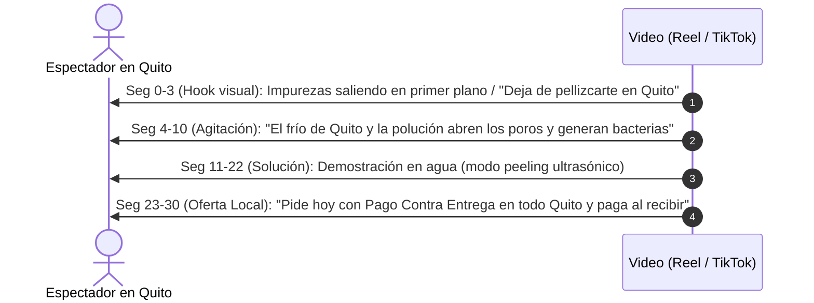

# Playbook Operativo: Lanzamiento y Automatización en Quito

Este manual detalla los pasos prácticos, comandos del CLI y protocolos de venta contra entrega para operar el negocio de dropshipping en Quito compitiendo contra los mayoristas tradicionales.

---

## 1. Estructura del Entorno de Trabajo

El espacio de trabajo en `c:\DropS-Scalanze` ha sido configurado con las siguientes herramientas instaladas:

```
c:\DropS-Scalanze\
├── market_intelligence_quito.py     <-- CLI central de inteligencia y finanzas
└── tools\
    ├── alicelabs-scraper\          <-- Deal Score con IA y señales de mercado en vivo
    ├── instagram-account-scraper\  <-- Motor Python para scraping de perfiles y reels
    ├── social-media-research-skills\ <-- 13 habilidades de IA para análisis de contenido
    └── web-scraper-dropshipping\   <-- Extractor de catálogos y márgenes de AliExpress/Amazon
```

---

## 2. Uso del Motor CLI (`market_intelligence_quito.py`)

Puedes ejecutar el motor desde la terminal de PowerShell en cualquier momento:

### A. Resumen General del Mercado
Muestra competidores clave en Quito, la simulación financiera completa y los hooks con mayor retención:
```bash
python market_intelligence_quito.py
```

### B. Simulación Financiera Personalizada
Calcula el margen neto real, ROAS de equilibrio y Deal Score ingresando costos específicos:
```bash
python market_intelligence_quito.py --finance --cost 6.50 --pvp 27.99 --cpa 5.00
```

### C. Auditoría de Cuentas Locales en Instagram
Extrae métricas públicas del perfil de un distribuidor en Quito:
```bash
python market_intelligence_quito.py --audit mecimportadora
```

---

## 3. Protocolo de Reducción de Devoluciones (WhatsApp Antifraude)

> [!WARNING]
> En Ecuador, el riesgo principal del modelo contra entrega no es la venta, sino los paquetes rechazados ("novedades"). Si despachas a ciegas, la devolución puede superar el 30%. Con este protocolo de confirmación en 2 pasos, baja a menos del 12%.

### Paso 1: Mensaje de Confirmación Inmediata (Bot o Manual)
En cuanto el cliente llena el formulario en tu tienda online, se envía este mensaje por WhatsApp:

> *"¡Hola [Nombre]! Te saludamos de [Nombre de tu Tienda]. 🌸*
> 
> *Acabamos de recibir tu pedido de la **Espátula Ultrasónica Facial de Limpieza Profunda**.*
> *Para programar tu despacho con entrega a domicilio en Quito con **Pago Contra Entrega**:*
> 
> *📍 Dirección registrada: [Calle Principal, Número y Calle Secundaria]*
> *🏙️ Sector / Referencia: [Norte / Sur / Valles / Cerca de...]*
> *💵 Total a pagar en efectivo al repartidor: **$28.99 USD** (Envío Gratis)*
> 
> *¿Confirmas que habrá una persona en la dirección para recibir y pagar en las próximas 24 a 48 horas?*
> *(Responde **SÍ** para despachar tu paquete hoy mismo).*

### Regla de Oro:
**Nunca generar guía ni despachar un paquete si el cliente no responde afirmativamente con la confirmación de la dirección y el compromiso de pago.**

---

## 4. Estrategia de Creativos para Instagram Reels & TikTok

Para superar a los importadores mayoristas de Quito, no muestres el producto en su caja de cartón. Utiliza la estructura de 4 fases en videos de 20 a 35 segundos:



---

## 5. Próximos Pasos de Despliegue

1. **Configuración de Tienda:** Montar una landing page simple de producto único (vía Shopify o tienda local) con formulario COD (como *Releasit*).
2. **Conexión con Bodega:** Crear cuenta en **Dropi Ecuador** (`dropi.ec`) para acceder al inventario de proveedores en bodegas de Quito y Guayaquil sin comprar stock por adelantado.
3. **Pauta Publicitaria:** Activar campaña en Meta Ads (CBO o ABO) segmentando Quito (radio de 25 km), edades 21 a 45 años, con objetivo de *Clientes Potenciales* o *Conversión (Compra)*.
