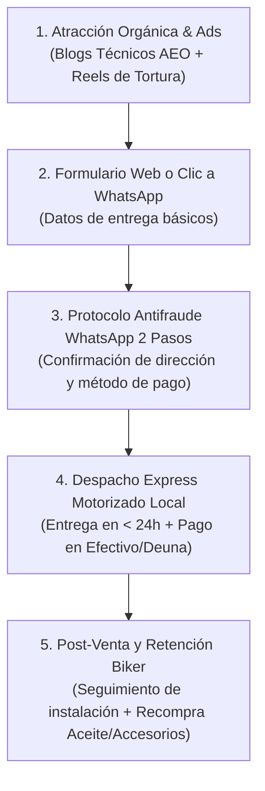

# Playbook Operativo: Dropshipping Biker Contra Entrega (COD) en Quito

Este manual detalla los procedimientos operativos estándar (SOP), comandos, protocolos de mensajería y logística de última milla para operar el negocio de dropshipping y distribución de accesorios de moto en Quito reduciendo las devoluciones a menos del 8%.

---

## 1. El Embudo Operativo de 4 Pasos



---

## 2. Protocolo WhatsApp de Confirmación Antifraude (Reducción de Devoluciones)

> [!CAUTION]
> En Ecuador, enviar un pedido contra entrega a ciegas sin confirmación directa por WhatsApp genera tasas de rechazo superiores al 25% (clientes que no están en casa, direcciones erróneas o compras por impulso arrepentidas). Con este protocolo de 2 pasos, la tasa de entrega efectiva supera el **92%**.

### Mensaje 1: Confirmación Inmediata de Pedido (< 3 Minutos)

En cuanto el cliente genera una orden en la web o escribe al WhatsApp oficial:

> *"¡Qué tal, mi pana! 🏍️ Te saludamos de **Panas Bikers Ecuador**.*
> 
> *Acabamos de registrar tu pedido de:*
> *👉 **[Nombre del Producto / Combo]** — Valor: **$[Monto] USD**.*
> 
> *Para coordinar la ruta de nuestro motorizado hoy mismo con **Pago Contra Entrega en Quito**:*
> 
> *📍 **Dirección exacta:** [Sector, Calle Principal, Número y Calle Secundaria]*
> *🏢 **Referencia:** (ej. Casa de dos pisos frente a la farmacia / Conjunto / Local)*
> *⏰ **Horario preferido para recibir:** (Mañana 9am-1pm / Tarde 2pm-6pm)*
> 
> *¿Nos confirmas si estos datos están correctos para alistar tu paquete?"*

---

### Mensaje 2: Confirmación de Despacho en Ruta (Día de la Entrega)

Cuando el repartidor sale con el paquete:

> *"¡Pana, tu pedido va en camino! 🚀*
> 
> *Nuestro repartidor **[Nombre del Motorizado]** llegará a tu dirección aproximadamente a las **[Hora estimada]**.*
> 
> *💰 **Total a pagar:** $[Monto] USD exactos.*
> *📱 **Métodos de pago aceptados:** Efectivo, transferencia directa Banco Pichincha o Deuna QR al momento de recibir.*
> 
> *(Recuerda que puedes revisar el producto y verificar su estado y funcionamiento antes de pagar).*
> *Cualquier novedad nos avisas por aquí. ¡Buenas rutas! ✌️"*

---

## 3. Protocolo de Prueba de Tallas en Calzado (Botas SPEED)

El 40% de moteros tienen dudas sobre el calce de las botas debido a variaciones entre marcas:
1. **Regla del Par Adicional:** En cada pedido de botas, el motorizado lleva en su maletero la talla solicitada y una talla adicional (ej. si pide 41, se despacha 41 y 42).
2. **Prueba en Puerta:** El cliente se prueba ambas botas sentado en su moto o en la entrada de su domicilio con sus medias habituales de rodar.
3. **Cero Fricción:** El cliente se queda con la talla exacta que le quedó perfecta y el motorizado retorna la otra a bodega. Esto anula al 100% las devoluciones por mala talla.

---

## 4. Logística de Última Milla en el Distrito Metropolitano de Quito (DMQ)

| Zona | Cobertura | Tiempo de Entrega | Costo Flete Motorizado |
| :--- | :--- | :---: | :---: |
| **Quito Norte** | El Condado, Carcelén, Cotocollao, La Carolina, Iñaquito, Monteserrín | 2 a 5 horas (Mismo Día) | \$2.50 – \$3.00 USD |
| **Quito Centro** | San Juan, Centro Histórico, La Marín, Itchimbía | 2 a 4 horas (Mismo Día) | \$2.50 – \$3.00 USD |
| **Quito Sur** | Villa Flora, El Recreo, Quitumbe, Guamaní, Solanda | 3 a 6 horas (Mismo Día) | \$3.00 – \$3.50 USD |
| **Valles** | Cumbayá, Tumbaco, San Rafael, Conocoto, Los Chillos | Mismo Día o 24 horas | \$3.50 – \$4.50 USD |
| **Provincias (Resto de Ecuador)** | Guayaquil, Cuenca, Ambato, Santo Domingo, Manta, Loja | 24 a 48 horas (Servientrega / LaarCourier COD) | \$5.00 – \$6.50 USD |

---

## 5. Script CLI de Simulación Financiera

Para calcular la rentabilidad neta de un producto antes de importarlo o lanzarlo en campaña, se utiliza el script:

```bash
python scripts/market_intelligence_panas_bikers.py --finance --cost 6.50 --pvp 22.00 --cpa 4.00 --flete 3.00
```

### Parámetros de la Fórmula Financiera Biker:
$$\text{Margen Bruto} = \text{PVP} - \text{Costo Producto}$$
$$\text{Margen Neto Limpio} = \text{PVP} - (\text{Costo Producto} + \text{Flete Local} + \text{CPA Ads} + \text{Tasa Devolución 8\%})$$
